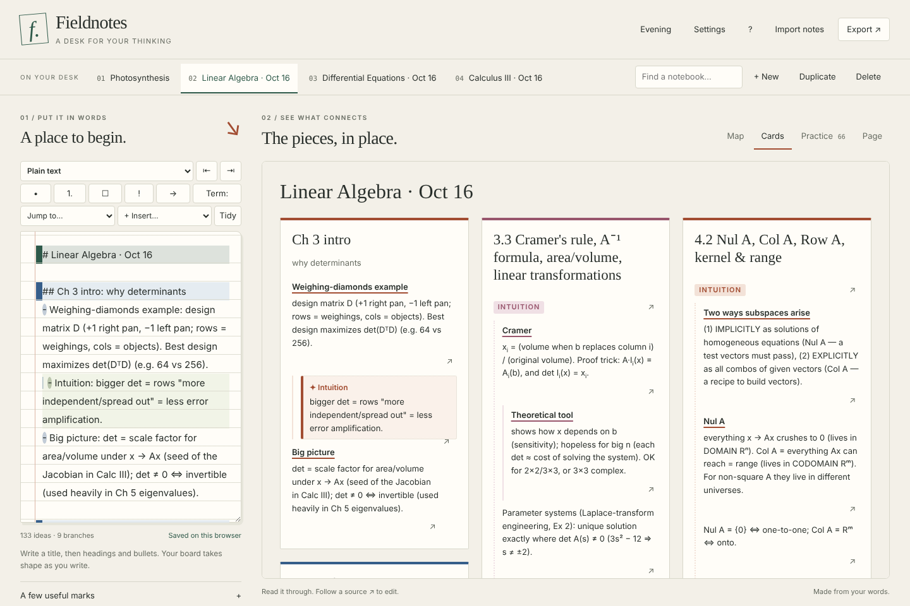

# Fieldnotes — text notes to visual notes

Fieldnotes is a local notebook that turns your words into a mind map, a board of reading cards, and recall practice. **Live site: https://rk68193-sys.github.io/Text-Words-To-Visual/** (GitHub Pages, deployed from the `main` branch root). You can also open **index.html** directly in a modern browser; no install, build, external fonts, account, or model API is required.

Developed in [rk68193-sys/-](https://github.com/rk68193-sys/-) (PRs #2–#4); this repository is the published copy.


[Evening preview](docs/fieldnotes-evening.jpg) · [Phone preview](docs/fieldnotes-mobile.jpg)

## New: math study notes and clear structure



- **Three course notebooks from the October 16 notes.** *Linear Algebra · Oct 16* (Lay 3.1–3.3, 4.1–4.2), *Differential Equations · Oct 16* (Zill 4.1–4.2) and *Calculus III · Oct 16* (Stewart 14.1–14.6). Every section is split into INTUITION and EQUATIONS / PROBLEM-SOLVING parts and ends with a quick self-test. They join your desk on their own the first time you open the site; deleting one is remembered. A fresh copy is always under **Borrow a starting point → Course notes**.
- **Line types instead of fiddling with spaces.** The **Line type** menu above the editor says what the current line is and changes it: Title, Section `##`, Sub-section `###`, Sub-sub-section `####`, Label, Bullet, Numbered step, Task or Plain text. It works on every selected line. Shortcuts: `Ctrl+Alt+1`–`4` for headings, `Ctrl+Alt+0` for plain text, `Ctrl+B` for a label (or bold the selected words), `Ctrl+Shift+8` / `7` for bullets and steps.
- **Labels make sub-sections.** A line in bold (`**INTUITION**`), in capitals (`PROBLEM-SOLVING`) or ending in a colon (`Light reactions:`) now owns the lines under it at the same indent, up to the next label or heading. Before, those bullets became its siblings. Press Enter after a label to start its first bullet.
- **Indenting that can't go wonky.** Tab / Shift+Tab (also `Ctrl+]` / `Ctrl+[`) move a line exactly one level and bring its sub-points along. A line can't sit more than one level deeper than the line above it, and odd spacing snaps to the two-space grid. Enter on an empty sub-bullet steps it back out one level.
- **Tidy** evens out a whole notebook: two spaces per level, tabs converted, every bullet `-`. It never changes what nests under what, and Ctrl+Z undoes it.
- **Guides in the editor.** Sections, sub-sections and labels get colored bands, each indent level gets its own rail, and study blocks are tinted, so the outline is visible while you type.
- **Jump to** lists every section and label; pick one to go to it.
- **Study blocks.** `Theorem 4.1.1 (Name): …`, `Definition …:`, `Proof:`, `Warning:` / `Watch out:`, `Tip:` / `Intuition:`, `Note:` and worked examples `Ex 3: …` are drawn as boxes in Cards and on the map. **+ Insert…** adds them, or math templates.
- **Math that looks like math.** `e^{2x}`, `x^2`, `(−1)^(i+j)`, `a_ij`, `y_{p1}` become real superscripts and subscripts. `[a b; c d]`, `|1 0; −3 2|` and `[[1,x,y],[1,x1,y1]]` become matrices and determinants in Cards and Practice. The map uses Unicode (e²ˣ, aᵢⱼ), and the handwriting writes exponents small and raised. Hand-drawn ∂ ∇ ⇔ ε δ ω ⟨ ⟩ ∈ ⊆ ⊥ ℝ ∀ ∃ were added for the handwritten pages.
- **Better practice for math courses.** Theorems become "State Theorem 4.1.1 (…)" cards and named definitions become "Define Wronskian (Definition 4.1.2)" cards. Numbered steps become one "List the steps" card. Headings, labels and the answers under a question no longer make cards of their own, and answers are copied exactly as written. Lines such as `If a_n(x) = 0 somewhere…` or `Nul A = {0} ⇔ one-to-one` are no longer mistaken for definitions.
- **Big notebooks open folded on the map**, down to their sections and labels, each showing how many ideas it holds. Select one to unfold it, or press **Unfold**.

## Beta: what's new


- **Page view, your notes in handwriting.** A fourth tab writes the current notebook out by hand on paper. Choose the handwriting (6 bundled fonts), pen (ballpoint, gel, pencil, fountain, felt tip, chalk), ink, a second accent ink for headings, terms and questions, a highlighter for `!` ideas, paper (college ruled, legal pad, graph, dot grid, plain, chalkboard), Letter or A4, writing size and messiness. **Download PDF** saves every page. Formulas get a hand-drawn box and tasks get hand-drawn check boxes. The engine comes from the Handwritten PDF Maker (PR #1); fonts and jsPDF are bundled, so it works offline.
- **Parser fixes.** `F = ma`, `E=mc^2` and `v = d / t` are formulas (shown boxed, with fill-in practice cards) instead of definitions. A term called `Key:` keeps its name. A deeper heading after a bullet (`####` under `##`) now nests under its section heading instead of under the bullet.
- **Desk management.** Delete a notebook (with Undo), duplicate one, and find notebooks by any words in them (`Ctrl+K`).
- **Focus a branch.** Select a branch on the map and press Focus (or `F`) to see just that part, with a "← Whole map" button (`Esc`).
- **Better practice.** Keyboard practice (`Space` reveals, `1` / `2` rate), shuffle, "Practice the ones I missed" at the end, and a list of questions still waiting for an answer with a link to each one.
- **Anki export.** Export → Practice cards for Anki saves a tab-separated file that Anki (File → Import) and most flashcard apps read.
- **Phone writing toolbar.** On phones and tablets, buttons above the editor indent, outdent, make headings, bullets, tasks and `!` marks, so you don't need a Tab key.
- **Settings.** Theme (including "match my device"), map lettering in any of the handwriting fonts, map text size, shuffled practice, and typing `->` to get →.
- **Shortcuts.** `Alt+1`–`4` switch views, `Ctrl+S` saves now, `Ctrl+E` jumps between the editor and the board, `?` lists everything.
- **Fixes.** A saved SVG keeps its words inside the boxes on computers without the same fonts (each line is pinned with `textLength`). Notes save shortly after you pause instead of rewriting storage on every key, and always before the tab closes. The Undo message no longer crowds phone screens.

## What changed after prototype PR #2

- **A notebook desk:** keep separate notebooks, switch between them, and add examples without replacing your work.
- **Practice:** definitions become question/answer cards, arrows become next-step questions, and questions with indented answers use exactly those written answers. Reveal, self-rate, and repeat missed cards. Questions without written answers are excluded.
- **Source navigation:** select any map idea, then Edit source; use ↗ next to a reading-card item or in Practice to select the original line in the editor.
- **Portable files:** import .md/.txt, export this notebook as Markdown, and back up all notebooks as JSON. Import a backup to add its notebooks without replacing existing ones.
- **Safer persistence:** saves are explicitly reported. Full/blocked/corrupt storage and stale tabs produce a persistent warning and backup action. The old single-note key migrates without being deleted.
- **Reachable maps:** Fit all really fits; arrow keys and click/tap Move controls pan. +/− zoom, Home fits, and selecting a branch exposes Fold/Unfold.
- **Paper-and-ink UI:** notebook tabs, serif headings, ruled writing space, restrained branch colors, daylight/evening themes, reduced-motion support, and a stacked phone layout.
- **Export fixes:** PNG/SVG build from the latest text even during the typing debounce. PNG dimensions and total pixels are bounded.
- **Print:** Export → Print study cards / PDF uses the browser's print dialog and always prints the current cards.

## Write naturally, add structure when useful

The first nonempty unbulleted line is the topic. Unindented lines become branches when there are no Markdown headings; otherwise use headings for branches and bullets for ideas.

```text
Cell biology
## Energy
**INTUITION**
- ATP: the cell's energy currency
- Light → excited electrons → ATP
- Where is DNA stored?
  - In the nucleus
- ! Follow the evidence
- e.g. a plant cell
**EQUATIONS**
- Theorem 1 (Energy balance): energy in = energy out + stored
- 6CO_2 + 6H_2O → C_6H_{12}O_6 + 6O_2
1. Find the limiting factor
2. Change one variable at a time
- [ ] Read chapter 8
```

Tab / Shift+Tab indent/outdent one level. Enter continues a list. Esc then Tab leaves the editor. Select map ideas with click, Enter, or Space; fold them using the selected-idea panel. Map movement works with arrows or the Move menu.

Practice ratings are your own check-in, not a mastery score. Sessions reset when the note text changes or the page reloads. This release does not schedule spaced repetition.

## Open and test

Double-click **index.html**, or serve this folder with any static HTTP server. Keep using the same origin/browser profile to keep browser saves together.

Requires Node 18+ for tests only:

```sh
npm test
```

84 tests cover the original parser/layout/render behaviors plus example-boundary regressions, source locations, notebook validation, migration, save denial/quota, stale writes, source-grounded study cards, recall sessions, and the beta additions: formulas, the Key/heading fixes, delete/undo/duplicate/search, shuffle and missed cards, Anki escaping, map text size, SVG text pinning, and handwritten page layout (margins, page breaks, accent ink across wrapped lines). tests/study.test.js covers labels and sub-sections, study blocks, theorem/definition/steps cards, math rendering (superscripts, subscripts, matrices, escaping), line types, one-level indenting, Tidy keeping the tree unchanged, the Jump to list, one-time delivery of the course notebooks, and the three notebooks themselves.

## Privacy and limits

Notes stay in this browser. There are no outbound API calls or external assets; fonts and the PDF library ship in this folder. Browser storage is not a durable backup: exporting JSON is the recovery path, and browser/file origins can differ. No automatic cross-device sync, encryption, OCR, AI cleanup, collaborative editing, or long-term practice scheduling is included.

Storage conflict checks detect normal stale-tab writes; this is not a transactional database. Close extra editing tabs before continuing. If storage is unreadable, the app preserves it and blocks overwriting; download your in-memory notes before repairing browser storage. Text imports are limited to 2 MB; extremely large/deep maps are not a supported workload.

The existing docs/screenshot-*.png images in the original PR depict the earlier interface. See **docs/REVIEW-AND-ROADMAP.md** for findings, prioritized ideas, UI alternatives, and the review checklist for Claude.

## Files

- js/parser.js — notes structure, kinds (labels, study blocks, worked examples), and source lines
- js/structure.js — line types, one-level indenting, Tidy and the section list for the editor (pure, tested)
- js/mathtext.js — superscripts, subscripts and matrices for cards, the map and the handwriting (pure, tested)
- js/course-notes.js — the course notebooks that ship with the site
- js/layout.js — map geometry and reading-card grouping
- js/render.js — escaped SVG/HTML and canvas exports
- js/notebooks.js — validated persistence, notebook desk actions, recall model and Anki export, shared with Node
- js/handpage.js — notes → handwritten lines → pages (pure, tested)
- js/hand.js, js/symbols.js — drawing handwriting, paper and hand-drawn symbols on a canvas
- fonts/ — six handwriting fonts (SIL Open Font License / Apache 2.0, licences alongside)
- vendor/ — jsPDF 2.5.1 (MIT) for the PDF download
- js/app.js — editor, notebook/file actions, views, and camera interactions
- css/styles.css — responsive paper-and-ink design and print styles
- tests/ — behavior and regression tests
